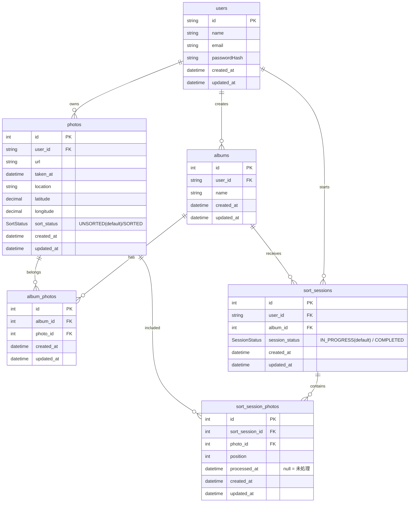

# photo-sorter

**写真を大きく確認しながら、スワイプで手軽に仕分けができるWebアプリです。**
似た写真が何枚もたまってしまい、整理に時間がかかる。そんな悩みを、スワイプによる連続した操作で解決することを目指して開発しました。

## デモ

公開URL：https://photo-sorter-drab.vercel.app/

## デモアカウント

デモユーザー1

- メールアドレス：photosorter@test.com
- パスワード：password123

> デモアカウントは複数の方が利用する共有アカウントです。アップロードした写真は、他の利用者に閲覧・削除される可能性があります。顔・個人情報・位置情報などを含む写真のアップロードはお控えください。

## 要件定義

### 開発の背景・目的

似た写真が大量にあると、小さなサムネイルで比較したり、写真を1枚ずつ開いて削除したりする必要があり、整理に時間がかかります。
写真を大きく確認しながら、左右のスワイプで連続して選別できるようにすることで、写真整理の負担を減らすことを目指しました。

### 想定ユーザー

- 旅行や友人との外出で写真をたくさん撮る方
- 似た写真の中から残したい写真を選びたい方
- スマートフォンやPCのブラウザで写真を整理したい方

### 機能要件

- メールアドレス・パスワードでアカウントを作成し、ログイン・ログアウトできること
- 複数の写真をアップロードできること
- アップロードした写真を一覧・詳細画面で確認できること
- 写真を大きく表示し、スワイプで「残す・残さない」を選別できること
- 残したい写真をアルバムに追加できること
- アルバムを作成し、アルバム内の写真を確認できること
- 不要な写真をアプリ上から削除できること
- アルバム内の写真をZIP形式でまとめてダウンロードできること

### 品質・操作上の要件

以下を設計・確認の基準としています。

| 項目 | 要件 |
| --- | --- |
| 対応端末 | スマートフォンを基本に、PCでも操作できること |
| 写真の確認 | 仕分け画面では、写真の縦横比を保ち、大きく表示できること |
| データの保護 | ログイン状態とデータの所有者を確認し、他のユーザーの写真・アルバムを操作できないこと |
| アップロード | 進捗と失敗した写真を表示し、失敗分を再試行できること |


## 画面・操作イメージ

1. ログインします。
2. 整理したい写真をアップロードします。
3. スワイプで写真を「残す・残さない」に仕分けます。
4. 残したい写真をアルバムで整理し、必要に応じてダウンロードします。

> 本アプリは、端末の標準写真アプリと自動同期するものではありません。アプリ上で写真を削除しても、端末内の元の写真は削除されません。

## 機能

| 機能 | 内容 | 状態 |
| --- | --- | --- |
| 認証 | メールアドレス・パスワードによるサインアップ、ログイン・ログアウト | 実装済 |
| 写真のアップロード | 複数の写真を選択して取り込む | 実装済 |
| 写真一覧・表示 | 取り込んだ写真を一覧で確認する | 実装済 |
| スワイプ仕分け | 写真を大きく表示し、「残す・残さない」を選別する | 実装済 |
| アルバム管理 | アルバムを作成し、表示する | 実装済 |
| 写真の削除 | 不要な写真をアプリ上から削除する | 実装済 |
| ZIPダウンロード | アルバムの中身をまとめてダウンロードする | 実装済 |
| 仕分けの再開 | 中断した仕分けの続きから再開する | 今後実装予定 |

## ER図



### 制約

- sort_session_photos：sort_session_id と photo_id の組み合わせは一意
- sort_session_photos：sort_session_id と position の組み合わせは一意

## 技術スタック

| レイヤー | 採用技術 |
| --- | --- |
| フロントエンド | Next.js 16.4.3（App Router）, React 19.2.8, TypeScript 5.9.3 |
| スタイリング | Tailwind CSS 4.3.3 |
| アイコン | Lucide React 1.45.0 |
| スワイプUI | @daformat/react-swipeable-cards 1.0.4 |
| バックエンド | Next.js 16.4.3（Route Handlers） |
| 認証 | Auth.js（NextAuth）5.0.0-beta.32, bcryptjs 3.0.3 |
| ORM・DB接続 | Prisma 7.10.1（Client：7.10.0）, pg 8.23.0 |
| データベース | PostgreSQL（Supabase） |
| 画像ストレージ | Supabase Storage |
| デプロイ | Vercel |
| ソースコード管理 | Git / GitHub |

## 外部API・サービスの利用

| 外部API・サービス | 利用目的 | 利用方法 |
| --- | --- | --- |
| Supabase Storage API | 写真ファイルの保存・取得・削除 | `@supabase/supabase-js`を使用。サーバーでアップロード許可を発行し、ブラウザから写真を直接送信。写真表示には署名付きURLを利用 |
| Supabase PostgreSQL | ユーザー・写真・アルバムなどのデータ管理 | Prismaとpgを通じてDBへ接続。Storage APIとは別のDB接続として利用 |

認証はAuth.js（NextAuth）で行っています。Supabaseの公開用キーだけでユーザー本人を識別する構成ではなく、サーバーでログイン状態と保存先の所有者を確認します。
Supabaseの秘密鍵はサーバー側だけで使用します。


## ローカルでの起動方法

Node.js・npmと、Supabaseのプロジェクトが必要です。

### 1. インストール

```bash
git clone https://github.com/night1010tya/photo-sorter.git
cd photo-sorter
npm install
```

### 2. 環境変数の設定

`.env.local`に以下を設定してください。

| 名前 | 内容 |
| --- | --- |
| `AUTH_SECRET` | Auth.jsの認証用シークレット |
| `SUPABASE_URL` | SupabaseのプロジェクトURL |
| `SUPABASE_SECRET_KEY` | サーバー専用の秘密鍵 |
| `NEXT_PUBLIC_SUPABASE_URL` | 同じSupabaseのプロジェクトURL |
| `NEXT_PUBLIC_SUPABASE_ANON_KEY` | Supabaseのanonキー |

DB接続用の環境変数は、Prismaの設定に合わせて別途設定してください。
秘密鍵や環境変数ファイルはGitにコミットしないでください。

### 3. DB・ストレージの準備

Supabase Storageに非公開の`photos`バケットを作成し、DBにマイグレーションを適用します。

```bash
npx prisma migrate deploy
```

### 4. 起動

```bash
npm run dev
```

http://localhost:3000 にアクセスし、新規登録して利用してください。


## 現在の課題・今後の改善

- **写真の取り込み・保存にかかる手間の軽減**
  - 写真の選別前にアップロード、選別後にダウンロードが必要なため、操作の手間を減らせるよう、取り込みから保存までの流れを改善したい。

- **写真一覧の表示速度の改善**
  - ページ遷移時の待ち時間を短縮するため、初回に取得・表示する写真の枚数を制限し、「さらに表示」ボタンで追加の写真を読み込む方式を導入したい。

- **撮影情報を保持したダウンロード**
  - 写真に含まれる撮影日時や位置情報などのEXIF情報を保持し、ダウンロード後も元の撮影情報を利用できるようにしたい。

- **Webアプリとしての制約**
  - 本アプリは端末の写真ライブラリと直接連携しないため、写真のアップロードとダウンロードが必要です。選別操作はスワイプで簡略化していますが、取り込み・保存には手間が残ります。
  - 将来的には、端末内の写真を直接整理できるスマートフォンアプリとしても展開していきたい。
